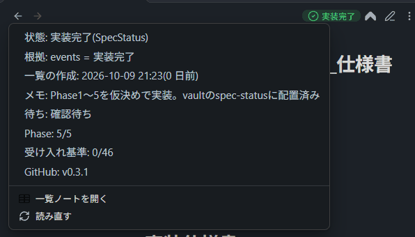

# Status Badge

Obsidian で仕様書や説明書を開くと、そのノートの「実装状況」を見出し部の右に印で出すプラグインです。
状態は [SpecStatus](https://github.com/takosasi-dev/spec-status)(仕様書の実装状況ボード)の JSON と、ノートの frontmatter から**写すだけ**で、自分では決めず、vault のファイルを1つも書き換えません。PC と iPhone・Android で動きます。



*English summary is at the bottom.*

## できること

- **仕様書の印**: 開いたノートのパスが SpecStatus の JSON(`00_実装状況.json`)の文書に当たれば、その状態(実装完了・一部未実装・着手済・未着手・撤退・証拠なし)を色とアイコンと文字で出します。
- **説明書の印**: 設定したフォルダのノートは、frontmatter の `状態:` の値をそのまま出します。
- **押すとメニュー**: 状態・根拠・食い違い・一覧を作った日時・メモに加えて、SpecStatus の JSON にあれば 待ち・Phase・受け入れ基準のチェック・脆弱な依存(一番重い物と上げる先の版)・仕様が変わった日・止まっている日数・GitHub の版も出します。「一覧ノートを開く」「根拠のノートを開く」「読み直す」もここから。
- **食い違い・古さ**: SpecStatus が食い違いを見つけた物は下線、一覧が設定の日数より古いと薄く出します。
- **自動で読み直す**: SpecStatus が JSON を書き直すと、操作なしに印が新しくなります。説明書の `状態:` を書き換えたときも同じです。
- **状態の一覧パネル**: 右の欄に、仕様書と説明書を状態ごとに畳める組で並べます。押すとノートを開きます(左のリボンのアイコンかコマンドで開く。iPhone でも使えます)。
- **状態で探す**: 検索窓で「確認待ち」「未着手」や名前を打って絞り、そのまま開きます。
- **下の帯の待ちの件数**: 「実物待ち 49・確認待ち 22」のように出し、押すと待ちで絞った検索窓が開きます(PC だけ)。
- **ファイル一覧の色の点**: ファイル一覧の各行の右に、状態の色の点を出します(設定で切れます)。
- **変わった物の知らせ**: SpecStatus が一覧を書き直したとき、状態が変わったプロジェクトを通知で知らせます(設定で切れます)。
- **説明書の状態を変える**: 説明書の印のメニューから、frontmatter の状態を設定の表の値に変えられます。
- **進捗を記録する**: 仕様書の印のメニュー・一覧パネルの鉛筆・コマンドから窓を開き、状態・終えたフェーズ・待ち・メモを変えられます。SpecStatus の記録のフォルダに、この端末用のファイル(`obsidian-…jsonl`)を作って1行足します。SpecStatus が一覧を作り直す前でも、新しい記録を読んで印にすぐ出します(iPhone だけでも使えます)。
- 英語の画面: Obsidian の言語が日本語以外なら英語で出します(状態の値はそのまま)。
- コマンド: 「状態を読み直す」「実装状況の一覧ノートを開く」「状態の一覧パネルを開く」「状態で探す」「今のノートの進捗を記録する」(既定のホットキーは無し)。

## 使い方の前提

- 仕様書の印には、[SpecStatus](https://github.com/takosasi-dev/spec-status) が vault の中に出す JSON が要ります(既定の場所 `仕様書MDファイル/00_実装状況.json`。設定で変えられます)。SpecStatus が無くても、説明書の印(frontmatter の `状態:`)だけで使えます。
- iPhone などで使うときは、JSON がその端末にも届いている必要があります。Obsidian Sync なら「他のすべてのタイプのファイルを同期」をオンにしてください。

## 入れ方

### BRAT で入れる(おすすめ)

1. コミュニティプラグインの「BRAT」(Obsidian42 - BRAT)を入れて有効にする。
2. BRAT の設定 → 「Add Beta plugin」に `takosasi-dev/status-badge` を入れる。
3. コミュニティプラグインの一覧で「Status Badge」を有効にする。

BRAT は新しい版が出ると自動で取ってきます。iPhone・Android でも同じ手順で入れられます。

### 手で入れる

[Releases](https://github.com/takosasi-dev/status-badge/releases) から `main.js`・`manifest.json`・`styles.css` を落とし、vault の `.obsidian/plugins/status-badge/` に置いて、コミュニティプラグインの一覧で有効にします。

## 設定

| 項目 | 既定 | 内容 |
| --- | --- | --- |
| SpecStatus の JSON | `仕様書MDファイル/00_実装状況.json` | vault からのパス |
| 一覧ノート | `仕様書MDファイル/00_実装状況.md` | メニューから開くノート |
| SpecStatus の記録のフォルダ | `spec-status/data/events` | 進捗を記録すると、この中のこの端末用のファイルに1行足す。空なら記録しない |
| この端末の名前 | 自動(`obsidian-ios-ab12` など) | 記録ファイルの名前。端末ごとに別の名前にする。この設定は同期されない |
| 状態が変わったら知らせる | オン | 一覧を読み直したときに、変わった物を通知に出す |
| 説明書にも印を出す | オン | |
| 説明書のフォルダ | 空 | 1行に1つ。配下のフォルダも含む。frontmatter の状態を出したいフォルダを書く(例 `説明書/ツール`) |
| 状態のプロパティ名 | `状態` | |
| 印に状態の文字を添える | オン | 見出しが詰まる端末では切る |
| ファイル一覧に色の点を出す | オン | Obsidian の作りに頼るので、本体の更新で出なくなることがある |
| 一覧が古いとみなす日数 | 7 | 空なら古さの印を出さない |
| 値ごとのアイコンと色 | 6状態+導入済み | 1行に「値 \| アイコン名 \| 色の系統」。アイコンは Lucide の名前、系統は ok・partial・progress・todo・stopped・other |
| 「一覧に無い」の印を出すフォルダ | 空(出さない) | JSON に無い md に「一覧に無い」の印を出す |

## 安全のための決まり

- vault のファイルを消さない・動かさない。書くのは3つだけ: このプラグインの設定(`data.json`)、メニューで説明書の状態を選んだときのそのノートの frontmatter のその項目、進捗を記録したときの SpecStatus の記録のフォルダの中のこの端末用のファイル(行を足すだけ。既にある行は変えない)。仕様書・一覧ノート・JSON は書き換えない。
- 状態は JSON か frontmatter の文字をそのまま出す。言い換えたり推測したりしない。
- ネットワークに出ない。Obsidian の画面の中身は探さない・読まない。印は公開 API の `addAction`、ファイル一覧の点は自分のスタイルシート(本体の `data-path` 属性に当てる CSS)で付けるだけ。
- Node.js や Electron の機能を使わない(モバイルでも動く)。

## 開発

```
npm install
npm run build        # main.js を作る(型チェックつき)
npm test             # vitest
npm run lint         # eslint-plugin-obsidianmd
SB_DEV_PLUGIN_DIR=<開発用 vault>/.obsidian/plugins/status-badge npm run deploy:dev
```

## ライセンス

MIT。[LICENSE](LICENSE) を見てください。

---

## English summary

**Status Badge** shows the implementation status of the open note as a badge in the view header.

- For specification notes, it reads the JSON written by [SpecStatus](https://github.com/takosasi-dev/spec-status) and shows the status exactly as written (no re-mapping or guessing). Clicking the badge shows the reason, conflicts, when the list was generated, and extra fields such as waiting, phase, acceptance-criteria checks, vulnerable dependencies (with the version to upgrade to), spec changes, stale days and the GitHub release.
- For other notes in configured folders, it shows the value of a frontmatter property (default `状態`).
- Also: a status panel in the right sidebar (grouped by status), a "Find by status" command, a waiting count in the status bar (desktop), colored dots in the file explorer (via its own stylesheet; can be turned off), a notice when statuses change, and changing a guide note's status from the badge menu.
- Record progress from Obsidian (badge menu, panel, or command): status, finished phase, waiting and note are appended as one line to this device's own file in the SpecStatus records folder, and shown right away even before SpecStatus rebuilds its list.
- Safe by design: it never deletes or moves vault files; it writes only its own `data.json`, the one frontmatter property of a guide note when you pick a status from the menu, and append-only lines in this device's record file when you record progress. Specs, the list note and the JSON are never modified. No network requests. It does not query or read Obsidian's DOM. Works on desktop and mobile.
- Install with [BRAT](https://github.com/TfTHacker/obsidian42-brat) (`takosasi-dev/status-badge`) or copy `main.js`, `manifest.json` and `styles.css` from the latest release into `.obsidian/plugins/status-badge/`.
- The UI is in Japanese, or English when Obsidian's language is not Japanese.
